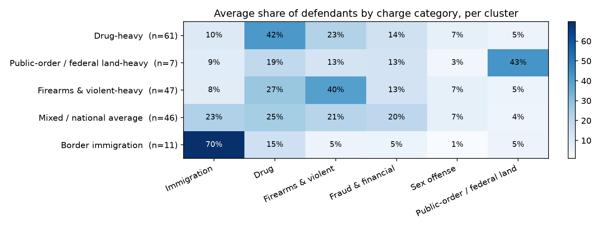
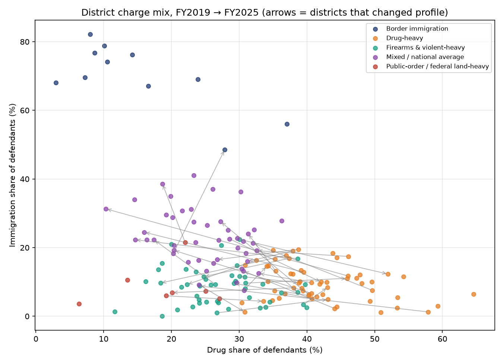

# District Prosecution Profiles from Federal Court Data

Which U.S. federal judicial districts prosecute similar mixes of crimes, and which ones changed between FY2019 and FY2025?

This project clusters 91 federal districts by charge mix using **Spark MLlib K-Means** on the Federal Judicial Center's Integrated Database. It is based on my component of a team course project at George Mason University (see [Background](#background)).



## Findings

**Five prosecution profiles:**

| Profile | What defines it | Example districts |
|---|---|---|
| Border immigration | ~70% of defendants charged with immigration offenses | Arizona, New Mexico, S.D. Cal., S.D. Tex., W.D. Tex. |
| Drug-heavy | ~42% drug | E.D. Ark., Hawaii, M.D. Ga. |
| Firearms & violent-heavy | ~40% firearms/violent | N.D. Ala., D.C., N.D. Ill. |
| Mixed / national average | Balanced mix, ~23% immigration | S.D. Fla., Massachusetts, E.D. La. |
| Public-order / federal land | ~43% traffic, trespass, curfew on federal property | E.D. Va., Maryland, E.D.N.C. |

**What changed from 2019 to 2025:**

- 32 of 81 districts changed profile.
- The largest movement was *Drug-heavy → Mixed* (11 districts), driven by immigration cases spreading to interior districts. Minnesota went from 6% to 28% immigration, Georgia-North from 12% to 31%, and Vermont from 8% to 21%.
- Border districts stayed put.
- The median district's immigration share rose from 9.9% to 12.4%.



→ Full analysis: [`notebooks/district_prosecution_profiles.ipynb`](notebooks/district_prosecution_profiles.ipynb)

## Method

1. **Data audit.** Before modeling, I checked the cleaned dataset and found four problems:
   - `prison_max_months = 999` is a placeholder for life, in 29% of rows.
   - 6,449 rows have the minimum prison range above the maximum.
   - The prison columns are statutory ranges looked up from the offense code, not imposed sentences, and `sentence_bucket` is derived directly from them.
   - "Case duration" is 0 for 91% of rows.

   None of these columns are used.
2. **Charge categories.** I mapped 182 offense codes into six categories (immigration, drug, firearms/violent, fraud/financial, sex offense, public-order). The mapping uses the U.S. Code title and offense description, because FJC offense codes don't group cleanly by numeric range.
3. **District × year profiles.** Each defendant counts once. A defendant with *n* charges contributes 1/*n* to each charge's category, so every profile sums to 1. District-years with fewer than 50 defendants are dropped, leaving 172 profiles.
4. **K-Means.** The features are proportions on the same scale, so they are not standardized. Standardizing would give rare categories as much weight as common ones. For each k from 2 to 8, I keep the best of 10 random seeds and compare WCSS and silhouette:
   - k=2 has the highest silhouette, but it only separates border districts from everyone else.
   - k=5 is the most interpretable choice near the k ≥ 3 peak.
   - Stability across reruns: median adjusted Rand index (ARI) of 0.86.
5. **Shift detection.** I compare each district's FY2019 and FY2025 cluster.

### Iteration history

[`notebooks/original/kmeans_clustering_v1_submitted.ipynb`](notebooks/original/kmeans_clustering_v1_submitted.ipynb) is the version I submitted for the course, unchanged. It clustered ~117k individual charge rows and picked k=2, which mostly reproduced felony vs. misdemeanor. Looking back, it had three problems:

- It used `sentence_bucket` as an input, which leaked the answer into the features.
- It treated the 999 placeholder as 999 months.
- It chose k from a single random seed, which caused a non-monotonic elbow.

The current notebook fixes all three and changes the unit of analysis to districts.

## Running it

```bash
pip install -r requirements.txt          # PySpark needs Java 11+
export FJC_DATA_PATH=/path/to/fjc_cases_cleaned.json
jupyter notebook notebooks/district_prosecution_profiles.ipynb
```

The notebook also runs on Databricks unchanged. Set `DATA_PATH` to your volume path. See [`data/README.md`](data/README.md) for the expected input.

## Limitations

- The data records **charges filed, not outcomes**. Most FY2025 cases were still pending when the data was pulled.
- Charge categories come from keyword rules: transparent, but not perfect.
- With only two snapshots, the analysis shows *that* a district changed, not the trajectory in between.
- The input file came out of the team's ETL pipeline, which isn't part of this repo.

## Background

This started as a team project for AIT-614-002 (Dr. Lindi Liao, George Mason University, Spring 2026), a broader "Federal Criminal Court Analytics Platform" with:

- data ingestion and codebook mapping
- a Databricks ETL pipeline
- MongoDB descriptive analytics
- a Random Forest classifier
- association rules
- statistical analysis

**Team:** Allison Denenberg, Reham Kablaoui, Noor Salem.

I owned the clustering component and contributed to the descriptive analytics. This repository contains only my work, and the rework above was done after the course ended.

## Data source

Federal Judicial Center, [Integrated Database (IDB)](https://www.fjc.gov/research/idb), criminal defendants, FY2019 and FY2025. The data is public and not redistributed here.
